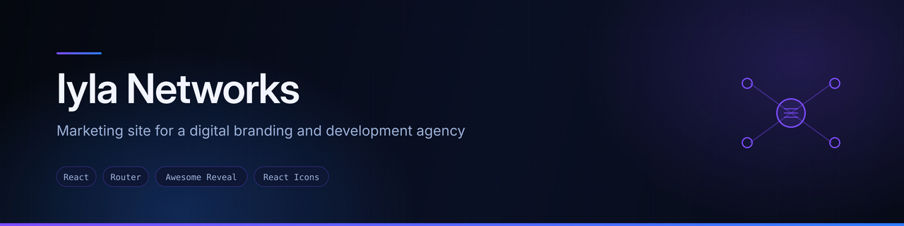
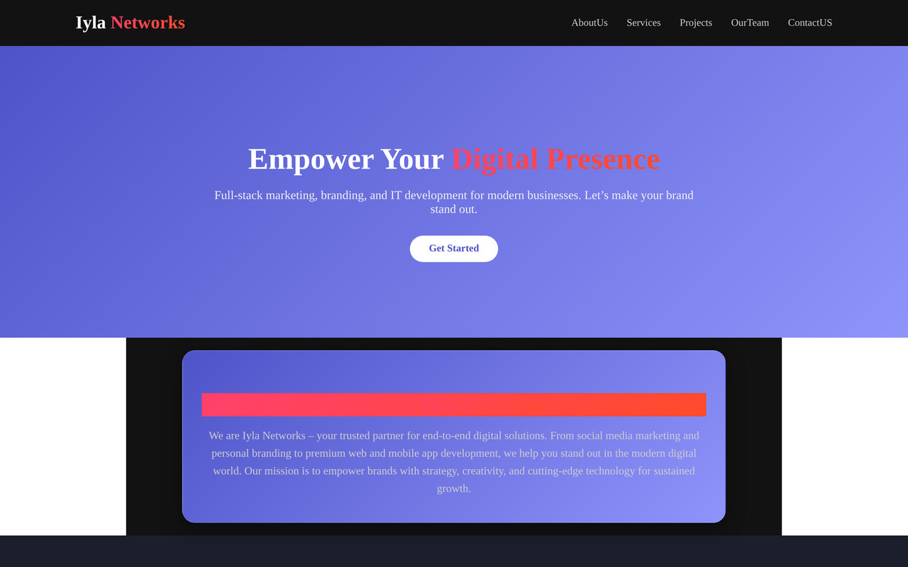

<div align="center">
  
</div>

<div align="center">


</div>

## Overview

Marketing website for **Iyla Networks**, a digital agency offering social media marketing, personal branding, and web and mobile development. The site is a pitch: who the agency is, what it does, the work it has done, and the team behind it.

Built as a six-route React site with scroll-triggered reveals and a landing page that composes every section in sequence, so a visitor can either scroll the whole story or jump to a single page.

## Preview



<sub>Screenshot captured from a local production build of this repository.</sub>

## Features

- **Landing page** composing Hero, About, Services, Projects, Team, Testimonials and CTA in one scroll
- **Six routes** — `/`, `/aboutus`, `/services`, `/projects`, `/ourteam`, `/contactus` — so each section also has a page of its own
- **Scroll-triggered reveal animations** on every section, via `react-awesome-reveal`
- **Services, project and team sections** rendered from component-level data
- **Testimonials** and a call-to-action block
- **Responsive layout** across desktop, tablet and mobile

## Tech stack

| Layer | Technology |
|---|---|
| Framework | React (Create React App) |
| Routing | React Router DOM — 6 routes |
| Animation | `react-awesome-reveal` (requires `@emotion/react`) |
| Icons | React Icons |
| Styling | Hand-written CSS per component |

## Project structure

```
src/
├── Components/
│   ├── LandingPage/     Composes every section in order
│   ├── Hero/, About/, Services/, Projects/, Team/
│   ├── Testimonials/, CTA/, Contact/
│   ├── Navigation/      Navbar, Footer
│   └── Animations/      Shared reveal wrappers
├── Pages/               AboutUs, ServicesPage, ProjectsPage,
│                        OurTeam, ContactUs
└── App.js               6 route definitions
```

## Running locally

```bash
git clone https://github.com/AJAY2043/Iyla-Networks.git
cd Iyla-Networks
npm install
npm install @emotion/react @emotion/styled
npm start
```

> **Note the second install.** `react-awesome-reveal` needs `@emotion/react` as a peer dependency and it is missing from `package.json`. Without it, `npm run build` fails with `Module not found: Can't resolve '@emotion/react/jsx-runtime'`. Adding both to `dependencies` would fix this properly.

```bash
npm run build     # production build into ./build
```

## Known issues

- **Missing peer dependency** — `@emotion/react` and `@emotion/styled`, as above. This is the first thing to fix.
- **Low-contrast section heading.** The "About Us" heading renders red on a red gradient band and is effectively invisible. Worth a colour fix.
- **Default page title.** `public/index.html` still has `<title>React App</title>` and the Create React App favicon — both should carry the Iyla Networks brand.
- **Unused dependencies.** `framer-motion`, `react-responsive-carousel`, `react-scroll` and `react-helmet` are declared but never imported.

## Future improvements

- Fix the items above, starting with the peer dependency
- Wire the contact form to a delivery service so enquiries arrive
- Add meta tags and an Open Graph image for link previews
- Replace placeholder project and team imagery with real material
- Accessibility pass — contrast, heading order, reduced-motion support

## Author

**Ajay Krishna Reddy Bhavanam** — Melbourne, Australia
[LinkedIn](https://linkedin.com/in/ajay-krishna-reddy) · [GitHub](https://github.com/AJAY2043)
